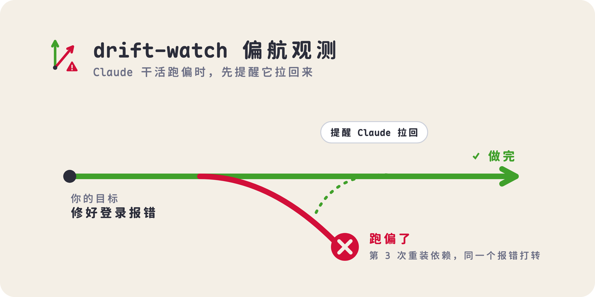

<p align="center">
  <picture>
    <source media="(prefers-color-scheme: dark)" srcset="assets/banner-dark.png">
    
  </picture>
</p>

# drift-watch 偏航观测

Claude Code 插件：把你的最初目标、计划和实际操作放在一起看，发现反复打转时先提醒 Claude；提醒后还再犯，可以暂停等你决定。航行日志保留目标、进度与卡点，方便对话压缩后接着做。

## 第一次用？跟 AI 说这三句话

1. **「帮我装这个插件：https://github.com/Ryumuu/drift-watch」** 把这句连同网址发给 Claude，它会自己读仓库、完成安装，装好后照提示重开一次对话。
   <details><summary>想自己手动装</summary>

   在 Claude Code 对话里输入 `/plugin install drift-watch --marketplace Ryumuu/drift-watch`，问是否添加 marketplace 时选 `y`，范围选 user。桌面版也可以在**输入框旁 + → Plugins → Add marketplace** 填 `Ryumuu/drift-watch`，再点 **Add plugin**。
   </details>
2. **「开始用偏航观测。」** AI 会先检查是否加载，有设置就沿用；第一次按你的用途提问，说明费用和数据去向，征得同意后才保存偏好。
3. **「跑一下偏航观测的示例。」** AI 会在唯一临时目录创建并修改一个小文本文件，再核对文件内容和插件实际生成的航行日志。不需要登录别的网站，也不需要 API 密钥。

卡住了就说 **「体检一下偏航观测」**。之前用 `--plugin-dir` 或本地目录装过同名插件的，本地那份会悄悄盖过新装的版本，先把它停用。

> 内置默认 `judgeModel=haiku`：开始任务后可能请求模型，消耗你自己的订阅额度；`off` 完全不调用插件判断模型。安装时可先选 `off`。向导对话本身仍使用 Claude 的正常额度。

## 能看到什么

- 输入框上方的小条：当前是否跑偏、偏离度、目标与阶段进度。
- 输入 `/drift` 打开面板：结论、航迹、操作和跑偏记录。
- 第一次提醒会把目标与问题交给当前 Claude；再犯时按设置暂停、拦下一步或继续提醒。
- 暂停后可以选「没问题，继续」「这是误报」或「让它换个思路」。换思路先保存航行日志，再尝试交接；没有侧会话工具就退回原会话。

它根据重复动作、重复报错、计划停滞等规则观察，模型可补充语义判断。偏离角和完成度是估计，不是正确性证明，也不能保证发现每一次跑偏。只故意偏题一次不一定提醒；`off` 不做语义判断。

## 支持的宿主与限制

需要支持 **function hooks（函数钩子）** 的 Claude Code 宿主。本仓库在 2.1.303 和 2.1.309 上检查过；这不代表所有历史版本或所有桌面客户端都已实机验证。安装命令可识别不代表函数钩子一定可用，遇到加载失败先体检。

| 使用环境 | 小条和面板 | 换个思路 |
| --- | --- | --- |
| 交互终端版 | 有文字小条、文字面板和按钮；航迹用文字摘要 | 缺少桌面会话工具时，在原会话中纠偏 |
| 支持该接口的桌面版 | SVG 小条、航迹图和面板按钮 | 开侧会话需要 `ccd_session.start_session`；分屏另需 `ccd_window.open_session_in` |
| 无界面的 `-p` / SDK | 不承诺显示小条或面板；按宿主支持情况运行 hooks、日志 | 不承诺交互按钮或侧会话 |

侧会话开启失败会尝试 `ccd_session.spawn_task` 交接卡片；卡片也不可用，或航行日志没写成，就回到原会话换思路。接手会话再次卡住会暂停，不会无限开新会话。桌面功能取决于当前宿主是否暴露这些工具，不是装插件就自动获得。

## 日常怎么用

先说清要做什么。你在会话中发出的第一句普通消息会成为目标，后续消息在任务未完成时算补充；计划全部完成后，下句可成为新任务。目标最多记录前 300 个字符。任务较长时把明确步骤列进待办，规则进度才有依据。

| 入口 | 作用 |
| --- | --- |
| `开始用偏航观测` | 向导先看状态；已有设置直接沿用 |
| `改设置` | 问需要调整的偏好，保存前给你确认 |
| `体检一下偏航观测` | 只查本地加载、设置、日志与宿主能力，不联网验证模型 |
| `跑一下偏航观测的示例` | 创建临时文本成果，读回真实日志与目标 |
| `/drift` | 打开面板 |
| `/drift new 你的目标` | 清空当前目标、计划、步骤，建立新任务；保留旧日志和累计统计 |
| `/drift goal 新目标` | 修改当前目标，保留已有计划与步骤 |

开始真实工作前，可用 `/drift new 你的真实目标` 切换，避免把向导对话当作任务。Skill 的文件入口是 [skills/drift-guide/SKILL.md](skills/drift-guide/SKILL.md)，详细流程在 [使用向导](skills/drift-guide/references/onboarding.md)。

## 设置与费用

在宿主 `/config` 的插件选项中修改；没有该入口时，可合并写入本机设置（见下节）。安装后按宿主要求重载或新开会话，核对运行中的值再认为生效。

| 设置 | 可选值和作用 | 内置默认 |
| --- | --- | --- |
| `escalation` | `remind` 再提醒；`pause` 中断当前轮等你决定；`block` 下次普通工具操作前拦住，让 Claude 解释 | `pause` |
| `judgeModel` | `haiku` / `sonnet` 概括目标和进度、估计偏离角、可疑时判断离题；`off` 完全不调用这些模型 | `haiku` |
| `logDir` | 本机绝对路径；空字符串使用默认目录。自定义路径先展开 `~` | `""` |
| `apiKeychainService` / `apiKeychainAccount` | 可选，macOS 钥匙串中你自己的 Anthropic API 密钥条目名 / 账户名 | `""` |

`block` 不是安全沙箱，也不是拦所有操作：计划工具先按原逻辑执行。接手会话又卡在同一处时会暂停。`off` 保留规则与日志；有待办时按完成条目比例显示进度，没有待办时可能没有百分比。

模型开启时，不仅可疑才会请求：插件约每 4 秒检查是否需要后台概括目标、阶段和进度，或给积攒的步骤估角；达到条件才真正发请求。判断与概括会把**目标、补充、计划和最近几步的操作摘要**交给模型，部分请求也含错误摘要。常见凭据格式会脱敏，但这不是对私人内容的完整清除保证。

密钥来源顺序：已配置的 macOS 钥匙串条目 → 环境变量 `DRIFT_WATCH_API_KEY` → Claude Code 自带模型通道。没有自备密钥时消耗你自己的 Claude Code 订阅额度；自备密钥走 Anthropic API 账户计费，请求失败可能退回宿主。直连 API 的超时不保证远端请求已取消。插件不另收费用，也不承诺固定单次成本。`off` 不发插件模型请求，当前 Claude 对话仍正常消耗额度。

不要把 API 密钥发给 AI 或贴进聊天、README、仓库；需要时自己在钥匙串或环境变量配置。向导和体检不会读取钥匙串原值，也不会联网测试密钥。

### 安全合并已有 settings.json

通常文件是 `~/.claude/settings.json`（设置了 `CLAUDE_CONFIG_DIR` 时用该目录的 `settings.json`）。项目/托管设置可能覆盖它，先让向导核对有效设置。设置结构是 `pluginConfigs` → 插件键 → `options`。本仓库 marketplace 安装后实测键为 `drift-watch@drift-watch`；本地目录加载时可为 `drift-watch` 或 `drift-watch@inline`，以宿主报告的实际键为准。不要另建一份 profile。

优先用 `/config`。如果本机已有 Python 3，下面是**可以直接运行的完整合并示例**：保存 `pause + off + 默认日志目录`，用于先试规则路线；不改变插件内置默认。它会先备份旧设置，再保留其他键进行合并。**确认要保存这三个值后**，才在终端运行；下面使用本仓库 marketplace 安装后的键；本地目录加载时，先把 `plugin_key` 改为宿主报告的键。无需安装 Python 来跑向导，没有 Python 就让 AI 用已有文件工具按同样规则合并。

```bash
python3 - <<'PY'
import json, os, tempfile
from pathlib import Path

plugin_key = 'drift-watch@drift-watch'
selected = {'escalation': 'pause', 'judgeModel': 'off', 'logDir': ''}
config_dir = os.environ.get('CLAUDE_CONFIG_DIR')
p = (Path(config_dir).expanduser() if config_dir else Path.home() / '.claude') / 'settings.json'
if p.is_symlink():
    raise SystemExit('设置文件是链接，请让 AI 核对实际位置后再合并。')
original = p.read_bytes() if p.exists() else None
data = json.loads(original) if original is not None else {}

def object_at(parent, key):
    value = parent.setdefault(key, {})
    if not isinstance(value, dict):
        raise SystemExit('设置结构异常，未写入；请先体检。')
    return value

if not isinstance(data, dict):
    raise SystemExit('设置根节点不是对象，未写入。')
options = object_at(object_at(object_at(data, 'pluginConfigs'), plugin_key), 'options')
options.update(selected)
p.parent.mkdir(parents=True, exist_ok=True)
backup = None
if original is not None:
    fd, name = tempfile.mkstemp(prefix='settings.json.bak-', dir=p.parent)
    backup = Path(name)
    with os.fdopen(fd, 'wb') as f:
        f.write(original)
fd, name = tempfile.mkstemp(prefix='.settings-', suffix='.tmp', dir=p.parent)
tmp = Path(name)
try:
    with os.fdopen(fd, 'w', encoding='utf-8') as f:
        json.dump(data, f, ensure_ascii=False, indent=2)
        f.write('\n')
    if p.is_symlink() or (p.read_bytes() if p.exists() else None) != original:
        raise SystemExit('设置在合并期间发生变化，未覆盖，请重新体检。')
    os.replace(tmp, p)
finally:
    if tmp.exists():
        tmp.unlink()
assert json.loads(p.read_text())['pluginConfigs'][plugin_key]['options'] == options
print('设置已合并：', p)
print('原设置备份：', backup if backup else '原来没有设置文件')
print('请按宿主提示重载插件或新开会话，再核对生效值。')
PY
```

备份和新文件由 `mkstemp` 以仅当前用户可读写的权限创建。JSON 损坏时脚本报错并不写入，交给向导备份后修复。回退时让 AI 对比备份，只还原本插件改过的选项，别整份覆盖其他新增设置。

## 插件会运行、发送和读取什么

为了透明，这里把插件代码里所有对外动作列在一起：

- **发送**：模型开启时，把目标、补充、计划、最近操作摘要（部分含错误摘要）发给 Claude Code 自带模型通道；配置了自备密钥时改为直连 `https://api.anthropic.com/v1/messages`。不发往其他任何地址。`judgeModel` 设为 `off` 就不发这些请求。
- **运行**：只有填了 `apiKeychainService` 时，才运行 macOS 自带的 `/usr/bin/security find-generic-password` 读取那一条钥匙串密钥；不运行其他程序，不下载或安装任何包。
- **读取**：环境变量 `DRIFT_WATCH_API_KEY`（备用密钥来源）和 `HOME`（定位日志目录）；当前会话的消息与轮次（恢复目标用）；自己写的航行日志和 `band-pos.json`。
- **写入**：只写航行日志目录，以及手动开启调试时的 `/tmp/drift-band-diag.json`。
- **桌面会话工具**：点「让它换个思路」时调用宿主的 `ccd_session.start_session` / `spawn_task` 开侧会话或交接卡片、`ccd_window.open_session_in` 分屏；`/drift probe` 只调用 `get_window_layout` 和 `list_start_targets` 检查这些工具够不够得着。
- **替你发消息**：只在你点暂停面板上的「没问题，继续」或「让它换个思路」后，才向当前会话发一条继续或换思路的消息；第一次提醒是加进 Claude 的上下文，不是替你发言。
- 不修改 Claude 的权限设置；`block` 只拦下一步并要求 Claude 先解释。

## 数据保存在哪里

- 偏好由宿主保存在本机 `pluginConfigs`，不额外建立账号或上传偏好；宿主自身是否同步设置以其配置为准。
- 航行日志默认在 `~/.claude/drift-watch/航行日志/`，可用 `logDir` 更改；读不到 HOME 才退到插件目录的 `航行日志/`。日志为 Markdown，含最初目标、补充、计划、进度、改过的文件完整路径、卡点与部分报错、跑偏记录，以及末尾供交接读取的状态 JSON。
- 面板通过宿主状态保存当前任务，最多保留最近 60 步；日志记录关键节点，不是完整聊天备份。目标与补充也会加入当前会话模型上下文。
- 一个任务通常一份日志，关键更新时重写，约 4 秒检查一次；文件名是日期加目标前缀，同日同前缀任务可能复用文件。不要把它当不会覆盖的审计归档。
- 默认不自动清理旧日志。日志及文件名可能含任务信息，分享前先检查。桌面布局调试仅在手动开启 `band-pos.json` 的 `debug` 时写 `/tmp/drift-band-diag.json`（时间、布局坐标和宽度）。

## 怎么关闭、重置和卸载

- **只关额外模型请求**：`/config` 把 `judgeModel` 改成 `off`，按宿主提示重载；规则观察、日志还会继续。
- **完全停用**：在终端的 `/plugin` 管理界面禁用 drift-watch；桌面版在 Plugins 里关闭插件。若从本地目录加载，还要移除该会话的 `--plugin-dir` 或设置里的 `CLAUDE_CODE_PLUGIN_DIRS` 对应目录，再结束旧会话、新开会话确认停止。仅隐藏面板不会停用。
- **重置当前任务**：`/drift new` 会清空当前目标、计划和步骤，下一句当新目标；旧日志与累计统计保留。重置偏好前让 AI 列出要删的选项，确认后再做；删除模型选项会恢复默认 Haiku。
- **卸载**：在 `/plugin` 或桌面 Plugins 中选择 drift-watch 并卸载。插件不会主动删除已有航行日志、设置备份或自备密钥；这些如需清理，先核对路径和文件，再自行删除。不要把整个 `~/.claude` 删掉。

## 开发者：从本地目录检查

下载/克隆本仓库后，在仓库目录运行下面命令（`--plugin-dir` 是开发用入口，不是给普通用户的发布安装方式）：

```bash
claude --plugin-dir .
claude plugin validate .
claude plugin test .
```

`tsconfig.json` 继承 `.claude-plugin/types/tsconfig.json`。这个被忽略的目录由支持函数钩子的宿主在**交互式加载/热重载本地插件**时生成，不是仓库漏交的源码；`plugin validate/test` 不能代替该生成步骤。生成后用本机已有的 TypeScript 5.4 或更新版执行 `tsc -p .`，不要为检查自动联网安装包。

无交互会话（`-p` / SDK）或已安装插件缓存不会向插件目录生成类型。此时先用 `plugin validate` 和 `plugin test` 检查；需要完整类型检查时，从**同版本**宿主提供的 `claude-code.d.ts` 头部取得 tsconfig 模板，在仓库外建临时配置、提供相应 `claude-code` / 工具类型声明，再把本仓库源文件纳入检查。拿不到匹配声明就报告「完整类型检查尚未运行」，不要伪造空声明、提交本机类型缓存或把 validate 当成 tsc 通过。

桌面小条默认按约 883px 参考宽度设置，窗口或其他插件布局不同时，可在插件根目录用 `band-pos.json` 调整 `slot`、`blueR`、`lookC`、`cell`。这是高级布局选项，不影响规则与日志。

## 许可

[MIT](LICENSE) · Ryumuu
